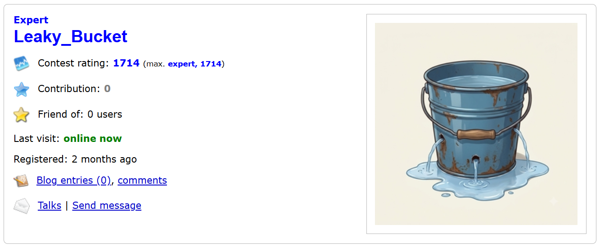

# Hi, I'm Aditya Putsala 👋

### Data Scientist · Machine Learning Engineer

**IIT Bhubaneswar** graduate · **Codeforces Expert** · Python, SQL and Machine Learning

---

## 👨‍💻 About Me

I'm an electronics engineer from IIT Bhubaneswar who moved full-time into **Data Science and Machine Learning**. I turn raw data into decisions: cleaning it carefully, testing more than one modelling approach, and explaining the result in plain language that business teams can act on.

My competitive-programming background (Codeforces Expert) gives me a strong algorithmic mindset, and I'm currently deepening my skills in deep learning, MLOps, NLP and computer vision through the Scaler Data Science and Machine Learning program.

---

## 🏆 Achievements

| | Achievement |
|:-:|-------------|
| 🏅 | **Codeforces Expert** with a contest rating of **1714** |
| 🎯 | **Qualified the UPSC Prelims**, placing in the **top 2.5% of 200,000+ candidates** |
| 🎓 | **B.Tech in Electronics and Communication Engineering, IIT Bhubaneswar**, with minors in Statistics and Computer Science |
| 📜 | **4 certifications from the Scaler Data Science and Machine Learning program**: Advanced Supervised Algorithms, Unsupervised Learning and RecSys, Deep Learning and Neural Networks, and MLOps |
| ⚡ | Cut registration time by **more than 2 minutes** and built phone-number validation for **15 international markets** as a front-end developer intern |
| 🤝 | Led NSS (National Service Scheme) drives that cleared **950 kg of waste** from two villages and organised health camps collecting **500+ litres of donated blood** |

  
   <b>Codeforces rating progression</b> (Expert, 1688)

---

## ⭐ Featured Projects

### 🎬 [Zee Recommender Systems](https://github.com/Aditya-Putsala/zee-recommender-systems)

**A movie recommendation engine built five ways, from similarity-based methods to matrix factorization, on 1,000,209 ratings from 6,040 users across 3,706 movies.**

| | |
|---|---|
| **Problem** | Help viewers find movies they will enjoy, based on their own ratings and the ratings of similar users |
| **Data challenge** | A user-item matrix that is **95.5% empty**, handled with sparse (CSR) matrices |
| **Approaches** | Item-based filtering with **Pearson correlation**, **cosine similarity** (item-item and user-user), **KNN** on a sparse matrix, **SVD matrix factorization** (d = 4) and a **user-based** recommender for a brand-new user |
| **Evaluation** | **RMSE 0.8830** and **MAPE 0.2695** on an 80/20 train-test split |
| **Sanity check** | For *Liar Liar*, Pearson and KNN both return the same slapstick-comedy cluster: *Mrs. Doubtfire*, *Dumb & Dumber*, *Ace Ventura: Pet Detective* |
| **Extras** | Learned user and movie embeddings, projected to 2D with PCA for visualisation |

**Tech:** `Python` `pandas` `NumPy` `scikit-learn` `SciPy` `scikit-surprise` `Matplotlib` `Seaborn`

[**View the project →**](https://github.com/Aditya-Putsala/zee-recommender-systems)

---

### 📺 [Netflix Business Case Study](https://github.com/Aditya-Putsala/Business_Case_Netflix)

**A data-driven content strategy for Netflix: what to produce and where to grow, based on 8,797 titles.**

| | |
|---|---|
| **Business question** | Which type of content should Netflix produce, and how can it grow in different countries? |
| **Data work** | Fixed misplaced values, filled 7 missing ratings, merged duplicate rating labels, unnested multi-value columns (cast, director, country, genre) and engineered date and audience-group features |
| **Analysis** | 17 visualisations covering catalogue growth, movies vs TV shows, audience ratings, content length, countries, genres, creators and release timing |
| **Output** | Business insights and plain-language recommendations for executives |

**What the data showed**

- 📈 Additions grew from 82 titles in 2015 to a peak of **2,016 in 2019**, and **TV's share of new additions rose from 25.0% (2018) to 33.7% (2021)**.
- 🇮🇳 **India's catalogue is 92% movies**, with only 84 TV shows out of 1,046 titles, which makes it the clearest gap for TV.
- 🌍 Audience mix differs sharply by country: **Spain (84%) and Mexico (77%)** lean towards adult content, while **Egypt (68%) and India (57%)** lean towards teen content.
- 👶 Content for young kids is just **7.7%** of the catalogue, and only about **6%** of titles are older than 2000.
- 🗓️ **July and December** are the busiest months for additions, and **February** is the quietest.

**Tech:** `Python` `pandas` `NumPy` `Matplotlib` `Seaborn`

[**View the project →**](https://github.com/Aditya-Putsala/Business_Case_Netflix)

---

## 🧰 Tech Stack

**Languages**

**Machine Learning and Data**

**Visualisation and Tools**

**Core strengths:** Recommender systems · Collaborative filtering and matrix factorization · Exploratory data analysis · Data cleaning and feature engineering · Data visualisation and business insights · Model evaluation (RMSE, MAPE) · Statistics · Data structures and algorithms

**Currently deepening:** Deep learning and neural networks · MLOps · NLP · Computer vision

---

## 🎓 Education and Certifications

**Education**
- **Scaler:** Postgraduate program in Data Science and Machine Learning (May 2025 to Dec 2026, in progress)
- **IIT Bhubaneswar:** B.Tech in Electronics and Communication Engineering, minors in Statistics and Computer Science (2017 to 2021)

**Certifications (Scaler Data Science and Machine Learning)**
- Advanced Supervised Algorithms
- Unsupervised Learning and RecSys
- Deep Learning and Neural Networks
- MLOps

---

## 🧭 How I Work

- **Start from the business question.** Every analysis ends in clear recommendations backed by numbers, not just charts.
- **Clean the data carefully.** I fix misplaced values, handle missing data openly and document each decision.
- **Compare approaches instead of trusting one.** In Zee, I built Pearson, cosine, KNN and SVD recommenders and checked that they agree.
- **Explain results in plain language.** I write for decision-makers, not only for data scientists.

---

### 🤝 Let's connect

I'm looking for **Data Scientist** and **Machine Learning Engineer** roles.

